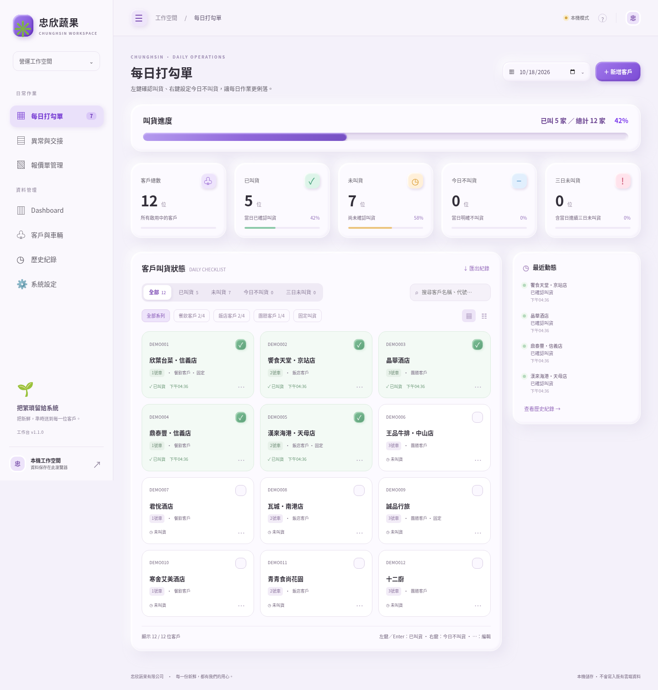

# 忠欣蔬果｜營運工作台

儲存庫：`chunghsin_20261018`



目前版本：**v1.1.0**。[本次功能、修改原因及升級步驟](docs/changes-v1.1.md) · [Dashboard 截圖](docs/dashboard.png)

純 HTML / CSS / JavaScript，三套作業整合到同一入口，可部署 GitHub Pages。紫色黏土風格、響應式、繁體中文。預設空白本機模式，不會自動連接附件舊網站的三個不同 Supabase 專案，也不會修改既有線上資料。

## 開啟網站

```sh
cd /workspace/chunghsin_20261018
npm run dev
```

靜態伺服器監聽 5173。無需建置；正式部署僅需 `index.html`、`styles.css`、`app.js`、`js/`。請透過 HTTP(S) 開啟，不使用 `file://` 載入 ES modules。

首次使用可點「載入示範資料」，或直接新增客戶。範例名稱不是實際客戶資料；僅能載入空白本機工作空間。

## 已實作流程

- **每日打勾單**：側欄可隱藏；最上方顯示帶光澤動畫的叫貨進度。整張卡片左鍵／Enter 叫貨、右鍵今日不叫貨、⋯ 編輯回改；四狀態（含自動三日未叫貨）、固定叫貨篩選、卡片／清單、搜尋、近期動態。每日公告與工作小提醒已移除，舊資料保留。
- **Dashboard**：資料管理中的月份統計，包含每日四狀態、完成率、客戶當月各狀態天數、原有系列及可自由選擇成員的自訂系列。狀態累計標為客戶日，避免與客戶家數混淆。
- **異常與交接**：表單、主檔／別名候選與車號快照、四種處理方式、九類異常、新增／編輯／刪除；清除當日需兩次確認且雲端由伺服器驗證管理員權限。清單每頁 50 筆。列印預覽可編輯、調字型字級、拖曳欄寬列高；異常每頁 16 列、交接至少 18 列；修改預覽不寫回資料。
- **報價單**：有／無貨號分頁、三階段篩選、客戶設定、三步匯入、多檔同格式、欄位範本、橫向多組展開、隱藏列排除、UTF-8 CSV、數字清洗、空白單價 0、實價清除不報價原因、新品與未匹配標示、主檔匯入、料號對照 CRUD／整批取代、依檔名批次匯入、Excel 合併匯出及單位衝突阻擋。整批替換使用交易；取消存檔不改匯出狀態。下載 fallback 會要求使用者確認下載成功後才標記。
- **共用資料**：客戶代號穩定識別、車輛主檔、客戶配送車輛關聯、停用客戶、Excel 客戶匯入、本機 JSON 備份還原、近 30 天歷史游標分頁與人工趨勢核對資料。
- **雲端**：Auth 登入、三種成員角色、CAS revision、request_id 去重、原子批次、順序提交的增量游標與 tombstone、只訂閱小型事件、30 秒水位檢查、重連補差、背景頁解除訂閱、失敗退避；無定期全表下載。

## Supabase 部署順序

1. **先備份舊專案**，執行 [sql/00_inspect.sql](sql/00_inspect.sql)，下載欄位、權限、索引、publication、筆數估計結果。資料量正式核對需另外執行精確 count。
2. 在測試專案依序執行 [sql/01_workspace.sql](sql/01_workspace.sql) 與 [sql/02_dashboard.sql](sql/02_dashboard.sql)；已有 v1.0 則只需執行 `02_dashboard.sql`。此腳本只新增 `cs_` 命名空間的工作台資料表與 RPC，**不會自動把舊表切換到新表**。沒有真正取得管理員連線，本次未在使用者的 Supabase 部署 SQL。
3. 在 Supabase Auth 建立內部成員（不開放任意人註冊），以 SQL 腳本末段範例把 Auth UUID 加到 `cs_members`。角色：`viewer` 唯讀；`staff` 日常新增編輯及報價明細替換；`admin` 可刪除報表、主檔、公告。前端隱藏按鈕不是權限保障，RPC 也會驗證。
4. 確認 `supabase_realtime` publication 包含 `cs_change_log`。若專案沒有該 publication，需在 Dashboard 啟用；腳本不會自行更動既有業務表的 publication。
5. 開啟網站「系統設定」，輸入**同一專案**的基本 URL 與 anon / publishable key，再登入成員帳號。不要填 `/rest/v1`；不要把 service_role／secret key 貼到前端。
6. 依 [遷移對照](docs/migration.md) 匯入並逐項核對。舊站在切換前仍維持原狀。須先確認要使用的正式 Supabase 專案與帳號權限；附件中的舊專案不會自動被寫入。
7. 完成 [驗收清單](docs/validation.md) 的真實裝置與雲端測試後再正式切換。

公開金鑰與設定存於該瀏覽器 localStorage；密碼只交給 Supabase Auth，不存入應用備份。登入 session 由 Supabase SDK 管理。本機與雲端資料分開：登入不會自動上傳本機資料，登出回到原本本機工作空間。

## GitHub Pages

Repository Settings → Pages → Deploy from a branch → `main` / root。網站程式與示範截圖已一併納入 Git 提交；GitHub Pages 需另外在儲存庫設定啟用。可在儲存庫首頁查看截圖，或點 Code → Download ZIP 下載完整程式。

不要把整個開發目錄（例如 `node_modules`、測試結果、備份 JSON）手動公開上傳。應用不會上傳 Excel 原檔或使用 Supabase Storage；讀取生成 Excel 所需資料仍計入 API egress。

## 測試

```sh
npm ci --cache /tmp/chunghsin-npm-cache
npm run check
npm test
# 另一個終端先 npm run dev
npm run test:browser
```

瀏覽器測試預設使用 `/usr/bin/chromium`，其他環境可設 `CHROMIUM_PATH`。本環境已驗證系統瀏覽器，不需另外下載 Playwright Chrome。測試 Excel 的第三方 script 由相同鎖定版本的 npm 資產供應，避免 CDN 不穩干擾功能測試；正式網站仍動態從 CDN 載入。

## 交付邊界

本版為整合重建，不是把三個舊 HTML 原封不動包進 iframe。舊版的巨型 JSON 快照／輪詢不繼續執行。尚未自動遷移舊雲端資料，也未驗證全部舊版特例；[遷移文件](docs/migration.md) 列出保留與待對照項目。晴天娃娃 LOGO、指定 PNG、實際 Excel 範本尚未提供，目前使用品牌文字與通用符號，未假稱已內嵌附件圖示。

真實 8／10 台同步、實際 Egress、長時間在線與正式資料表相容性均待帳戶整合驗收；本機通過不等於已上線或保證低於免費額度。

環境設定草稿另外保存了可重複安裝腳本與啟動說明，以及 Google Fonts 的兩個網域。草稿保存不代表已發佈；需在環境設定檢閱儲存後再 Publish environment。
